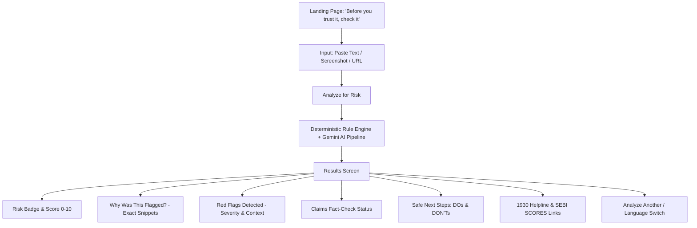

# ScamLens Bharat 🛡️🇮🇳

> **"Before you trust it, check it."**
> AI-Powered Investor Safety & Financial Misinformation Detection Platform for Indian Retail Investors.

---

## Table of Contents
1. [Problem](#problem)
2. [Solution](#solution)
3. [Features](#features)
4. [User Journey](#user-journey)
5. [Architecture](#architecture)
6. [AI & Rule Pipeline](#ai--rule-pipeline)
7. [Technology Stack](#technology-stack)
8. [Security](#security)
9. [Privacy & Zero-Storage](#privacy--zero-storage)
10. [Investor Guardrails](#investor-guardrails)
11. [Installation](#installation)
12. [Environment Variables](#environment-variables)
13. [Running Locally](#running-locally)
14. [API Documentation](#api-documentation)
15. [Testing](#testing)
16. [Deployment](#deployment)
17. [Demo Mode](#demo-mode)
18. [Post-Hackathon Production Roadmap](#post-hackathon-production-roadmap)
19. [Disclaimer](#disclaimer)

---

## Problem

Over 150 million Indian citizens have opened Demat and mutual fund accounts in recent years. However, retail investors—particularly **first-time investors, Tier-2/Tier-3 city savers, and elderly citizens**—are persistently targeted by organized financial scams across **WhatsApp, Telegram, SMS, Instagram, and fraudulent websites**:

- **Fictitious Guaranteed Returns**: "30% monthly return with zero risk."
- **Impersonation**: Unauthorized channels claiming endorsement from SEBI, NSE, or late legendary investors (e.g., Rakesh Jhunjhunwala).
- **Advance-Fee Fraud**: Demanding ₹5,000–₹50,000 "clearance margin" or personal UPI deposits before releasing fictional trading profits.
- **Credential Harvesting**: Forcing users to reveal banking OTPs, MPINs, or install malicious Android APKs.

Traditional antivirus and generic chat tools do not understand Indian statutory securities rules (SEBI/RBI mandates) and often hallucinate answers.

---

## Solution

**ScamLens Bharat** is an investor-protection intelligence tool engineered specifically for the Indian financial ecosystem. It allows users to paste suspicious messages, upload screenshots, or submit URLs to receive:

1. **Deterministic & AI Risk Scoring**: Transparent 0–10 risk indicator score.
2. **Red Flag Detection**: Pinpoints exact scam types (Guaranteed Returns, Fake SEBI affiliation, Urgency pressure, OTP theft).
3. **"Why Was This Flagged?"**: Shows the exact snippet that triggered the alert and explains the financial danger in plain language.
4. **Claim Analysis**: Fact-checks assertions (e.g., "SEBI approved trading group") and marks them **UNVERIFIED** or **MISLEADING** without inventing fake citations.
5. **Actionable DOs and DON'Ts**: Practical steps to protect savings, plus one-click links to the National Cyber Crime Reporting Portal (1930) and SEBI SCORES.
6. **Bharat-First Multilingual Accessibility**: Full native support for **English, Hindi (हिन्दी), and Telugu (తెలుగు)** with a **Simple Explanation Mode**.

---

## Features

- **Multi-Modal Ingestion**:
  - **Text Analysis**: Long WhatsApp forwards, SMS messages, and social media captions.
  - **Screenshot Analysis**: PNG, JPG, and WEBP image processing via Gemini Vision OCR.
  - **URL Safety Analysis**: Backend-safe domain reputation, HTTPS verification, and SSRF-protected metadata inspection.
- **Deterministic Rule Engine**: 9 critical heuristic patterns checking for OTP demands, unverified regulatory claims, personal UPI requests, and Hindi/Telugu scam keywords.
- **Hybrid AI Synthesis**: Gemini AI extracts nuance and summarizes context without overriding critical security rules.
- **Interactive Demo Showcase**: Built-in 3 pre-analyzed Indian scenarios (High-Risk Scam, Misleading Course, Low-Risk Educational Alert) for zero-latency testing.
- **Accessible Design**: High-contrast indicators, screen-reader friendly elements, distinct iconography (not just color coding), and responsive mobile layout.

---

## User Journey



---

## Architecture

ScamLens Bharat is structured as a robust full-stack monorepo:

```
scamdetector/
├── backend/
│   ├── src/
│   │   ├── ai/            # Gemini AI service & Zod schema validation
│   │   ├── controllers/   # Analysis, demo, and health handlers
│   │   ├── middleware/    # Rate limiters, security headers, upload guards
│   │   ├── routes/        # Express API routing
│   │   ├── rules/         # Deterministic rule engine & regex patterns
│   │   ├── services/      # Master analysis pipeline & demo dataset
│   │   ├── types/         # Shared TypeScript interfaces
│   │   ├── utils/         # SSRF-guarded URL fetcher & IP parser
│   │   ├── app.ts         # Express configuration (Helmet, CORS)
│   │   └── server.ts      # Server entrypoint
│   └── tests/             # Vitest test suites (Rules, URLs, APIs)
├── frontend/
│   ├── src/
│   │   ├── components/    # Reusable UI cards, meters, banners, uploaders
│   │   ├── i18n/          # English, Hindi, and Telugu dictionaries
│   │   ├── pages/         # LandingPage, AnalyzePage, ResultsPage
│   │   ├── services/      # Frontend API client
│   │   ├── types/         # Client-side types
│   │   ├── App.tsx        # View orchestration & language state
│   │   └── main.tsx       # Vite entrypoint
│   ├── index.html         # SEO metadata and Inter typography
│   └── tailwind.config.js # Accessible palette & brand tokens
└── package.json           # Root orchestration scripts
```

---

## AI & Rule Pipeline

The backend executes a defense-in-depth pipeline:

1. **Input Normalization**: Sanitizes input strings, handles unicode characters in Devanagari and Telugu.
2. **Deterministic Rule Engine**: Matches high-risk patterns (guaranteed returns, OTP demands, unregistered VIP groups). Calculates deterministic weights and sets a strict safety ceiling.
3. **Gemini Vision OCR (for Screenshots)**: Extracts textual claims and handles from chat screenshots.
4. **SSRF-Protected Fetching (for URLs)**: Resolves DNS, blocks private/loopback/cloud-metadata IPs (e.g., `127.0.0.1`, `169.254.169.254`), and extracts safe meta tags without executing untrusted client scripts.
5. **Gemini Multimodal Model**: Synthesizes natural-language explanations, extracts specific claims, and translates them into the target Indian language.
6. **Strict Zod Output Validation**: Enforces the JSON schema. If Gemini output is invalid or unavailable, the system automatically falls back to deterministic rule synthesis so analysis never fails.
7. **Rule Override Guard**: AI is strictly prevented from downgrading critical security violations (e.g., OTP requests always enforce `HIGH` risk).

---

## Technology Stack

- **Frontend**: React 19, TypeScript, Vite, Tailwind CSS, Lucide Icons, Framer Motion.
- **Backend**: Node.js v22, Express, TypeScript, Zod, Helmet, Express-Rate-Limit, Multer.
- **AI & Vision**: Google Gemini API (`@google/genai`).
- **Security & Networking**: `ipaddr.js` (SSRF/CIDR blocking), Axios with timeout & size limits, Cheerio.
- **Testing**: Vitest, Supertest.

---

## Security

- **Server-Side Request Forgery (SSRF) Protection**: Prohibits private IP ranges (RFC 1918), loopback addresses, link-local addresses, and AWS/GCP cloud metadata IPs (`169.254.169.254`).
- **Rate Limiting**: Protects endpoints against automated abuse (120 requests / 15-minute window).
- **HTTP Security Headers**: Powered by `helmet`.
- **File Upload Safeguards**: Memory storage with 10MB hard limit and strict MIME validation (`image/png`, `image/jpeg`, `image/webp`).
- **Zero API Key Exposure**: The Gemini API key is isolated to the Node.js backend.

---

## Privacy & Zero-Storage

- **No Permanent Retention**: Submitted messages, uploaded screenshots, and analysis reports are processed in-memory and not stored in any database by default.
- **Sensitive Data Redaction**: The platform strictly prohibits capturing or storing bank passwords, MPINs, card CVVs, or OTPs.
- **Opt-In Architecture**: Any future reporting is designed with explicit user consent.

---

## Investor Guardrails

ScamLens Bharat is an **investor education and protection tool**, NOT a broker or trading platform.

The application strictly **DOES NOT**:
- Provide buy/sell/hold stock recommendations.
- Predict stock price targets or portfolio returns.
- Recommend specific brokers or mutual fund schemes.
- Collect OTPs, passwords, or payment credentials.
- Claim definite certainty unless legally proven; uses responsible wording like *"High-risk indicators detected"* or *"Unable to verify this claim"*.

---

## Installation

### Prerequisites
- **Node.js** >= 18.x (Tested on Node v22)
- **npm** >= 9.x

### Clone & Install
```bash
# Clone the repository
git clone https://github.com/your-username/scamlens-bharat.git
cd scamlens-bharat

# Install root dependencies
npm install

# Install backend dependencies
cd backend && npm install && cd ..

# Install frontend dependencies
cd frontend && npm install && cd ..
```

---

## Environment Variables

Copy the template file to `.env`:
```bash
cp .env.example .env
```

Configure your variables in `.env`:
```env
# Gemini API Key (Get free key from https://aistudio.google.com/)
GEMINI_API_KEY=your_gemini_api_key_here

# Backend Port
PORT=5000
NODE_ENV=development
FRONTEND_URL=http://localhost:5173

# Rate Limiting
RATE_LIMIT_WINDOW_MS=900000
RATE_LIMIT_MAX_REQUESTS=120
```

> **Note**: Even if `GEMINI_API_KEY` is left blank, ScamLens Bharat runs in full **Deterministic Rule Engine + Fallback Mode** with complete 100% offline analysis!

---

## Running Locally

### Development Mode (Both Backend & Frontend)
Run both services concurrently:

```bash
# Terminal 1: Backend
npm run dev:backend

# Terminal 2: Frontend
npm run dev:frontend
```

- **Frontend**: http://localhost:5173
- **Backend API**: http://localhost:5000
- **API Health Check**: http://localhost:5000/api/health

---

## API Documentation

### 1. `POST /api/analyze/text`
Analyzes text content for scam indicators.
- **Request Body**:
  ```json
  {
    "text": "SEBI approved group! Guaranteed 50% profit every month. Send OTP to join.",
    "language": "en"
  }
  ```
- **Response**:
  ```json
  {
    "success": true,
    "data": {
      "riskLevel": "HIGH",
      "riskScore": 10,
      "summary": "High-risk indicators detected across multiple critical security dimensions...",
      "redFlags": [...],
      "claims": [...],
      "safeActions": [...],
      "avoidActions": [...]
    }
  }
  ```

### 2. `POST /api/analyze/image`
Uploads a screenshot (`multipart/form-data`) for Vision OCR and risk analysis.
- **Form Fields**:
  - `image`: File (PNG, JPG, WEBP, max 10MB)
  - `language`: `"en"` | `"hi"` | `"te"`

### 3. `POST /api/analyze/url`
Performs SSRF-safe URL inspection.
- **Request Body**:
  ```json
  {
    "url": "https://master-trade-signals.xyz",
    "language": "en"
  }
  ```

### 4. `POST /api/analyze/demo`
Executes pre-computed demonstration cases without external API latency.
- **Request Body**:
  ```json
  {
    "caseId": "case-1-high-risk",
    "language": "hi"
  }
  ```

### 5. `GET /api/health`
Health check and configuration status.

---

## Testing

Comprehensive unit and integration tests are powered by Vitest and Supertest:

```bash
# Run all tests
npm test
```

### Test Coverage
- **`ruleEngine.test.ts`**: Verifies guaranteed return detection, OTP request detection, Hindi/Telugu keyword detection, and zero false-positives on benign educational circulars.
- **`urlAnalyzer.test.ts`**: Verifies private IP detection, SSRF protection against loopbacks and cloud metadata addresses, and suspicious TLD flagging.
- **`api.test.ts`**: Tests all Express routes, input validation errors, and demo mode endpoints.

---

## Deployment

### Frontend (Vercel)
1. Set the Root Directory to `frontend`.
2. Framework Preset: `Vite`.
3. Add Environment Variable:
   - `VITE_API_URL`: Your deployed backend URL (e.g., `https://scamlens-api.onrender.com`).
4. Build Command: `npm run build`.
5. Output Directory: `dist`.

### Backend (Render / Railway)
1. Set the Root Directory to `backend`.
2. Build Command: `npm run build`.
3. Start Command: `npm start`.
4. Add Environment Variables:
   - `GEMINI_API_KEY`: Your Google AI Studio API key.
   - `FRONTEND_URL`: Your Vercel frontend URL.
   - `PORT`: `5000` (or assigned port).

---

## Demo Mode

ScamLens Bharat includes 3 labeled sample cases for quick evaluation:

1. **High-Risk Investment Scheme**: WhatsApp forward promising 30% monthly return, requesting personal UPI transfer and Aadhaar/OTP copy.
2. **Misleading Financial Claim**: Finfluencer trading algorithm advertising an implausible 99.4% win-rate on a low-reputation domain.
3. **Low-Risk Educational Bulletin**: Official National Stock Exchange (NSE) circular advising investors to check SEBI registration and update Demat credentials.

All 3 demo cases are accessible with one click and support instantaneous English, Hindi, and Telugu language rendering.

---

## Post-Hackathon Production Roadmap

- **Expanded Language Roster**: Tamil, Kannada, Marathi, Bengali, and Gujarati.
- **WhatsApp Bot Integration**: Forward suspicious messages directly to an official WhatsApp Business verified line.
- **Official SEBI / SCORES API Integration**: Direct live API cross-checking against the SEBI registered intermediaries registry.
- **Voice Ingestion**: Audio message transcription for non-text WhatsApp voice notes.
- **Browser Extension**: Real-time warning on suspicious URLs when visiting trading and crypto websites.
- **Crowdsourced Misinformation Radar**: Anonymized community reporting database for newly emerging scam campaigns.

---

## Disclaimer

**ScamLens Bharat** provides educational and investor safety information. It is an independent public-good tool and does not provide financial or investment advice, endorse brokers or financial products, or guarantee the factual accuracy of third-party communications. If you have been the victim of financial fraud, immediately report it to the **National Cyber Crime Helpline at 1930** or visit [cybercrime.gov.in](https://cybercrime.gov.in).
